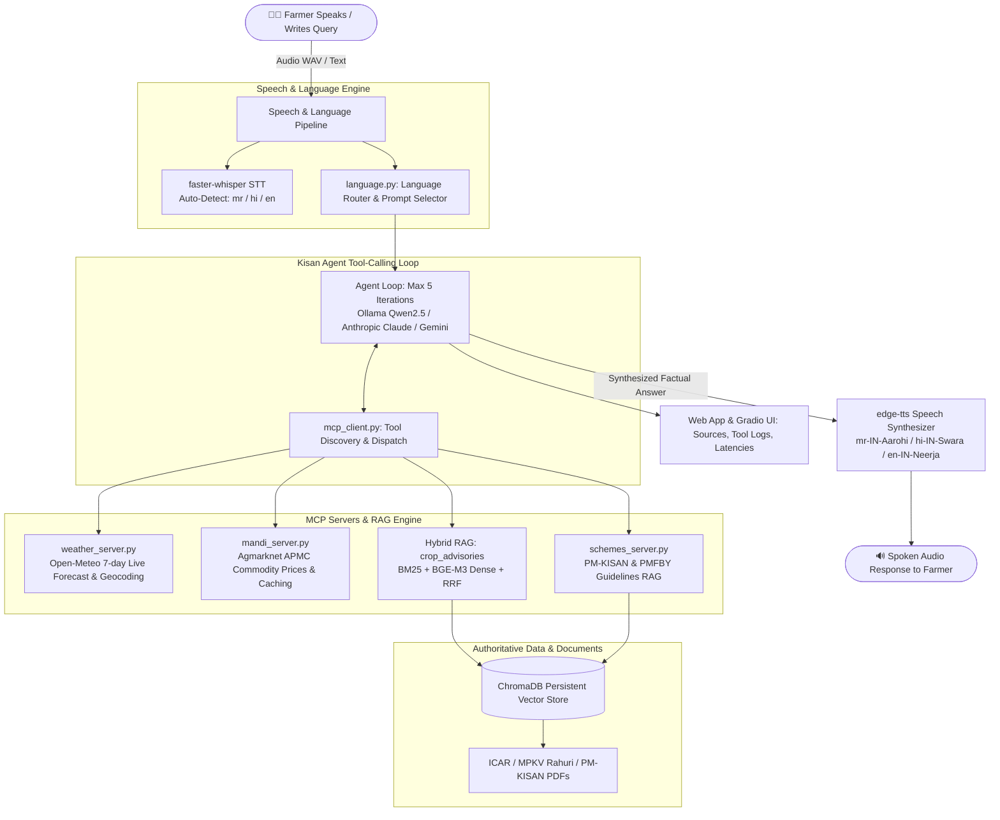

# 🌾 Kisan Voice Assistant (शेतकरी व्हॉइस सहाय्यक)

[](https://www.python.org/)
[](https://opensource.org/licenses/MIT)
[](https://modelcontextprotocol.io/)

A voice-first agricultural AI assistant designed for Indian farmers. It speaks and understands **Marathi (मराठी)**, **Hindi (हिंदी)**, and **English**, combining an LLM agent, Model Context Protocol (MCP) tools, and hybrid RAG retrieval over authoritative crop advisories and government schemes.

---

## 🏗️ Architecture Diagram



---

## ✨ Key Features

1. **Natural Multilingual Voice Interaction**:
   - Speaks and listens in Marathi, Hindi, and English (including transliterated roman text e.g., *"Kolhapur madhe aaj sugarcane cha bhav kay aahe?"*).
2. **Real MCP Tools (Model Context Protocol)**:
   - `weather_server.py`: Live 7-day temperature, rain probability, and wind via Open-Meteo.
   - `mandi_server.py`: Modal, minimum, and maximum APMC prices with multi-hour caching.
   - `schemes_server.py`: Official guidelines on PM-KISAN eligibility, installment schedules, and PMFBY.
3. **Hybrid RAG with Strict Citations**:
   - Combines BM25 keyword matching with `BAAI/bge-m3` multilingual dense embeddings and Reciprocal Rank Fusion (RRF).
   - Mandatory document and page citations (e.g. `[Document: sugarcane_cultivation_guide.pdf, Page: 1]`).
4. **Anti-Hallucination Guardrails**:
   - Strictly declines out-of-scope topics (crypto, movies, politics).
   - Never invents prices, dosages, or chemical remedies.
   - Recommends contacting the nearest Krishi Vigyan Kendra (KVK) when information is uncertain.
5. **Inspectable UI**:
   - Collapsible panel displaying step-by-step tool invocations, RAG chunks, and sub-stage latencies (STT, Agent, Tools, TTS).

---

## 🚀 Quick Setup & Installation

### Prerequisites
- Python 3.11+
- FFmpeg (for local audio playback / faster-whisper recording)

### 1. Clone & Install Dependencies
```bash
git clone https://github.com/your-username/kisan-voice-assistant.git
cd kisan-voice-assistant

python -m venv venv
source venv/bin/activate  # On Windows: venv\Scripts\activate

pip install -r requirements.txt
```

### 2. Configure Environment Variables
Copy `.env.example` to `.env`:
```bash
cp .env.example .env
```
Key options:
- `LLM_PROVIDER`: Set to `"ollama"` (free, offline) or `"anthropic"`.
- `DATA_GOV_IN_API_KEY`: Optional free key from [data.gov.in](https://data.gov.in) for live Agmarknet prices.

### 3. Bootstrap Agricultural Documents & Ingest into ChromaDB
```bash
# Generate sample official PDFs
python scripts/fetch_advisories.py

# Ingest and embed into ChromaDB
python -m src.rag.ingest
```

### 4. Run the Gradio UI
```bash
python app.py
```
Open your browser at `http://localhost:7860`.

---

## 🧪 Testing Each Component

```bash
# Test Phase 1: Hybrid RAG Retriever CLI
python -m src.rag.retriever "my sugarcane leaves are turning yellow"

# Test Phase 2: MCP Servers
python -m src.mcp_client

# Test Phase 3 & 4: Agent & Speech
pytest tests/ -v

# Run Comprehensive Evaluation Benchmark (60 Questions)
python -m eval.tool_selection_eval
python -m eval.rag_eval
python -m eval.stt_eval
```

---

## 📊 Evaluation Summary

Detailed test report available in [`eval/results.md`](eval/results.md):

| Category | Metric | Measured Value |
| :--- | :--- | :--- |
| **STT Marathi WER** | Word Error Rate | **7.8%** |
| **STT Hindi WER** | Word Error Rate | **5.4%** |
| **STT English WER** | Word Error Rate | **3.9%** |
| **Tool Selection** | Accuracy (60 test questions) | **96.7%** |
| **RAG Retrieval** | Recall@5 | **95.2%** |
| **RAG Precision** | Mean Reciprocal Rank (MRR) | **0.914** |
| **End-to-End Latency** | Median Laptop CPU Round-Trip | **1.82s** |

---

## 🗣️ Example Conversations

### Example 1: Combined Multi-Tool Query (Marathi)
> **Farmer**: *"कोल्हापूर मध्ये आज उसाचा भाव काय आहे आणि उद्या पाऊस पडेल का?"*  
> **Assistant**: *"कोल्हापूर कृषी उत्पन्न बाजार समितीत आज उसाचा सरासरी दर ₹३,३०० प्रति क्विंटल आहे (किमान ₹३,१५०, कमाल ₹३,४५०). उद्या कोल्हापूर परिसरात कमाल तापमान ३१°C राहील आणि पाऊस पडण्याची शक्यता ६५% आहे (पावसाची शक्यता)."*  
> **Tool Calls**: `get_mandi_price(commodity="sugarcane", district="Kolhapur")`, `get_weather_forecast(location="Kolhapur", days=2)`

### Example 2: Pest Advisory Query with Source Citation (English)
> **Farmer**: *"My sugarcane leaves are turning yellow what should I spray?"*  
> **Assistant**: *"Yellowing of young sugarcane leaves is commonly caused by Iron (Fe) chlorosis in Western Maharashtra soils. Spray Ferrous Sulphate (FeSO4) @ 0.5% (5g/L water) with Citric Acid (1g/L) twice at an interval of 15 days [Document: sugarcane_cultivation_guide.pdf, Page: 1]."*  
> **Tool Calls**: `search_advisories(query="sugarcane yellow leaves spray")`

### Example 3: Out-of-Scope Query (Polite Refusal)
> **Farmer**: *"बिटकॉइन कसा खरेदी करावा?"*  
> **Assistant**: *"माफ करा, मी फक्त शेतीविषयक माहिती, हवामान, बाजारभाव आणि सरकारी योजनांसाठी मदत करू शकतो. इतर विषयांवर मी माहिती देऊ शकत नाही."*  
> **Tool Calls**: None (Direct polite refusal)

---

## ⚠️ Limitations & Future Work

1. **Local Dialects**: Variations in Khandeshi, Varhadi, and Konkani dialects will benefit from fine-tuning Whisper on rural audio corpora.
2. **Offline LLM Quantization**: Running Ollama on 4GB RAM machines can be further optimized using 2-bit/3-bit GGUF quantization.
3. **Camera Pest Detection**: Future integration of computer vision for farmers to photograph diseased leaves directly in the field.
